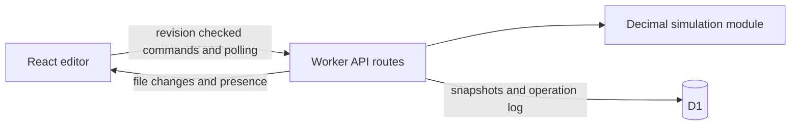

# Idle Economy Lab architecture

## Deployed system

The published application uses the Sites runtime. The browser UI is a React and TypeScript client using XYFlow, Zustand, and Recharts. The server routes are built by Vinext and run on Cloudflare Workers. Durable shared state is stored in D1. The Sites runtime does not run ASP.NET Core containers or PostgreSQL, so the hosted system uses its supported Worker and D1 services.

## Persistence model

The D1 schema has three tables:

- `game_files`: one JSON graph and simulation snapshot per file, with a monotonic revision and timestamps.
- `file_operations`: append-only saved revisions and file deletion events used by the change cursor.
- `participants`: file-scoped display name, color, cursor coordinates, and last-seen time.

Saved runs, metrics, offline settings, and file graph configuration are embedded in the game file document. Each logical simulation command writes a new file revision. The engine keeps at most 240 sampled points per live history; saved runs retain their sampled data and graph configuration.

## Collaboration and conflict handling

Clients submit graph edits after a short debounce and poll operation changes about once per second. Presence and cursor records refresh more often and expire after inactivity. Writes use compare-and-swap on the current D1 revision. Simulation commands include both the expected tick and revision, so conflicting commands are rejected and the latest snapshot is returned.

One active participant and one tab are elected to submit ticks. Compare-and-swap remains the final guard if two commands race. If a graph edit conflicts with a newer remote graph, the local unsaved graph is copied into a new file named `recovered edits`; the shared file receives the newer revision.

## Simulation rules

`src/engine.ts` is independent of React and HTTP route code. It uses Decimal.js for balances, costs, conversion ratios, rates, and prestige multipliers.

Each logical step applies these phases in order:

1. Check unlock and condition nodes.
2. Run enabled generators whose gates are met.
3. Run converters if all inputs and output capacity permit an atomic cycle.
4. Run the configured automation strategy in automated or hybrid mode.
5. Record resource balances, gross flows, net rates, levels, events, and milestone markers every five ticks.

An accepted speed command advances 1, 10, 100, or 1,000 logical steps in one request. Offline catch-up runs when a collaborator reopens a file that was left running. It applies one logical tick per elapsed second, respects the configured absence cap, and processes no more than 5,000 ticks per request.

## Routes

| Route | Purpose |
| --- | --- |
| `GET/POST /api/files` | List shared files and create a file |
| `GET/PUT/DELETE /api/files/:id` | Load, revision-save, or delete a file |
| `POST /api/files/:id/simulation` | Apply authoritative simulation commands |
| `GET/POST /api/files/:id/presence` | Refresh participant and cursor presence |
| `GET /api/changes?after=:cursor` | Poll revisions and deletions |

Before writes, the Worker checks graph size, node references, typed links, numeric bounds, and simulation controls. File edits remain ordinary JSON snapshots; user-provided expressions are never evaluated.

## Access and deployment

The owner requested public access. Anyone with the Site URL can open and edit all shared files. There are no accounts, per-file access controls, or private project data boundaries. Sites versions are packaged from the source commit, saved, and deployed as production releases.

## Platform differences from the attached brief

| Brief item | Hosted implementation |
| --- | --- |
| ASP.NET Core Web API | Vinext API routes on Cloudflare Workers |
| SignalR | Revision-checked HTTP polling and presence records |
| PostgreSQL and EF Core | D1 with Drizzle ORM |
| C# simulation engine | Shared TypeScript simulation engine with Decimal.js |
| Docker Compose | Not available as a Sites deployment target |
| Unattended background ticking | Not available; bounded catch-up occurs on reconnect |

These differences follow the Sites hosting runtime. A separate .NET and PostgreSQL stack would require a different deployment target and would not serve the currently published Site.
